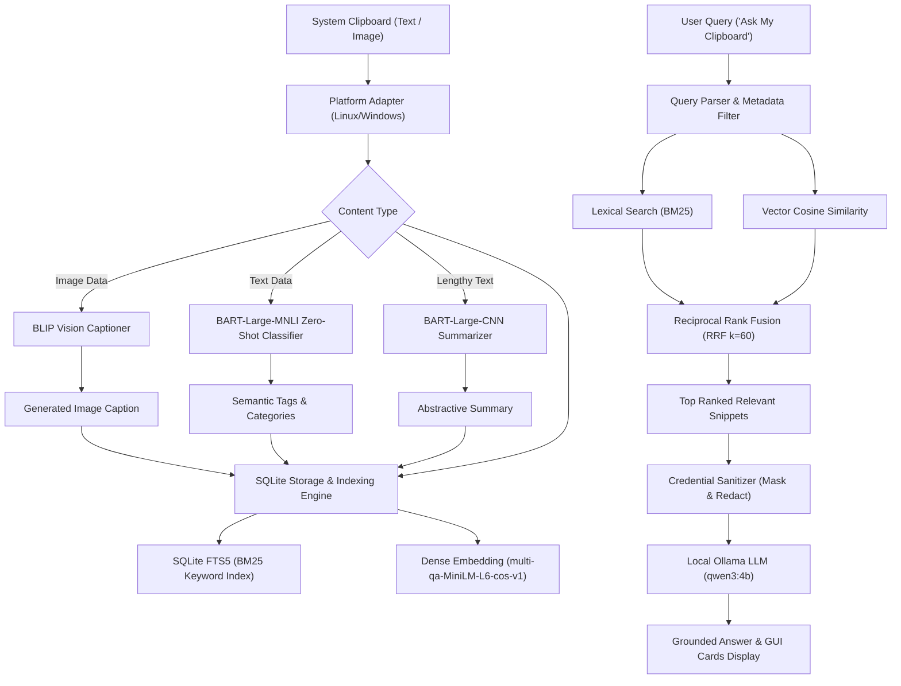
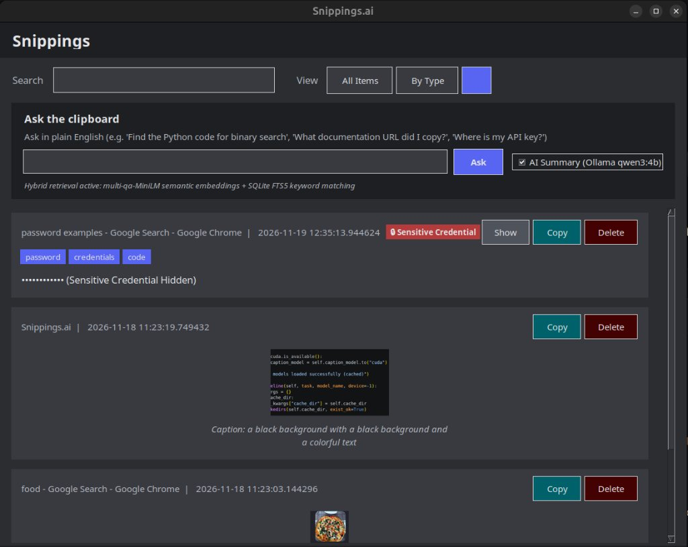

# A PROJECT REPORT ON
# “Snippings.ai: A Generative AI Based Context Aware Clipboard Manager”
### AS A COMPONENT OF
### *Generative AI and Large Language Models Lab AM4601-1*

---

 

# **NITTE** | **NMAM INSTITUTE OF TECHNOLOGY**
*(Deemed to be University)*  
*Nitte (DU) established under Section 3 of UGC Act 1965 | Accredited with ‘A+’ Grade by NAAC*

  

### A PROJECT REPORT ON
## **“Snippings.ai: A Generative AI Based Context Aware Clipboard Manager”**

#### AS A COMPONENT OF
### *Generative AI and Large Language Models Lab AM4601-1*

  

**SUBMITTED BY**

### **Ananya Shetty** &nbsp;&nbsp;&nbsp;&nbsp;&nbsp;&nbsp;&nbsp;&nbsp; **NNM23AM006**

  

**UNDER THE GUIDANCE OF**

### **Ms. SOUMYA SANTHOSHA**
**ASSISTANT PROFESSOR GD-III**  
**DEPARTMENT OF AI & ML, NMAMIT**

  

### **DEPARTMENT OF ARTIFICIAL INTELLIGENCE AND MACHINE LEARNING**
### **NMAM INSTITUTE OF TECHNOLOGY, NITTE**
### **2026-27**

---

# **NITTE** | **NMAM INSTITUTE OF TECHNOLOGY**
*(Deemed to be University)*  
*Nitte (DU) established under Section 3 of UGC Act 1965 | Accredited with ‘A+’ Grade by NAAC*

### Department of Artificial Intelligence and Machine Learning Engineering

 

## **CERTIFICATE**

Certified that the project work entitled **“Snippings.ai: A Generative AI Based Context Aware Clipboard Manager”** is a bonafide work carried out by as a component of **Generative AI and Large Language Models Lab AM4601-1**:

 

### **Ananya Shetty** &nbsp;&nbsp;&nbsp;&nbsp;&nbsp;&nbsp;&nbsp;&nbsp;&nbsp;&nbsp;&nbsp;&nbsp; **NNM23AM006**

 

in partial fulfilment of the requirements for the award of **Bachelor of Technology in Artificial Intelligence and Machine Learning Engineering** prescribed by Nitte Deemed to be University, Nitte, during the year **2026-2027**.

It is certified that all corrections/suggestions indicated for Internal Assessment have been incorporated in the report deposited in the departmental library.

The mini project report has been approved as it satisfies the academic requirements in respect of the mini project work prescribed for the Bachelor of Technology Degree.

   

**Signature of Guide** &nbsp;&nbsp;&nbsp;&nbsp;&nbsp;&nbsp;&nbsp;&nbsp;&nbsp;&nbsp;&nbsp;&nbsp;&nbsp;&nbsp;&nbsp;&nbsp;&nbsp;&nbsp;&nbsp;&nbsp;&nbsp;&nbsp;&nbsp;&nbsp;&nbsp;&nbsp;&nbsp;&nbsp;&nbsp;&nbsp;&nbsp;&nbsp;&nbsp;&nbsp;&nbsp;&nbsp;&nbsp;&nbsp;&nbsp;&nbsp;&nbsp;&nbsp;&nbsp;&nbsp;&nbsp;&nbsp;&nbsp;&nbsp;&nbsp;&nbsp;&nbsp;&nbsp;&nbsp;&nbsp;&nbsp;&nbsp;&nbsp;&nbsp;&nbsp;&nbsp;&nbsp;&nbsp;&nbsp;&nbsp;&nbsp;&nbsp;&nbsp;&nbsp;&nbsp;&nbsp;&nbsp;&nbsp; **Signature of HOD**  
*(Ms. SOUMYA SANTHOSHA)* &nbsp;&nbsp;&nbsp;&nbsp;&nbsp;&nbsp;&nbsp;&nbsp;&nbsp;&nbsp;&nbsp;&nbsp;&nbsp;&nbsp;&nbsp;&nbsp;&nbsp;&nbsp;&nbsp;&nbsp;&nbsp;&nbsp;&nbsp;&nbsp;&nbsp;&nbsp;&nbsp;&nbsp;&nbsp;&nbsp;&nbsp;&nbsp;&nbsp;&nbsp;&nbsp;&nbsp;&nbsp;&nbsp;&nbsp;&nbsp;&nbsp;&nbsp;&nbsp;&nbsp;&nbsp;&nbsp;&nbsp;&nbsp;&nbsp;&nbsp;&nbsp;&nbsp;&nbsp; *(Dr Sharada U Shenoy)*

  

### **Evaluation**

**Name of the Examiners** &nbsp;&nbsp;&nbsp;&nbsp;&nbsp;&nbsp;&nbsp;&nbsp;&nbsp;&nbsp;&nbsp;&nbsp;&nbsp;&nbsp;&nbsp;&nbsp;&nbsp;&nbsp;&nbsp;&nbsp;&nbsp;&nbsp;&nbsp;&nbsp;&nbsp;&nbsp;&nbsp;&nbsp;&nbsp;&nbsp;&nbsp;&nbsp;&nbsp;&nbsp;&nbsp;&nbsp;&nbsp;&nbsp;&nbsp;&nbsp;&nbsp;&nbsp;&nbsp;&nbsp;&nbsp;&nbsp;&nbsp;&nbsp;&nbsp;&nbsp;&nbsp;&nbsp;&nbsp;&nbsp;&nbsp;&nbsp;&nbsp;&nbsp;&nbsp;&nbsp;&nbsp;&nbsp;&nbsp;&nbsp; **Signature with Date**

1. \_\_\_\_\_\_\_\_\_\_\_\_\_\_\_\_\_\_\_\_\_\_\_\_\_\_\_\_\_\_\_\_\_\_\_\_\_\_\_\_\_\_\_\_\_\_\_\_\_\_\_\_\_\_\_\_\_\_\_\_\_\_\_\_\_\_\_\_\_\_\_\_\_ &nbsp;&nbsp;&nbsp;&nbsp;&nbsp;&nbsp;&nbsp;&nbsp;&nbsp;&nbsp;&nbsp;&nbsp;\_\_\_\_\_\_\_\_\_\_\_\_\_\_\_\_

2. \_\_\_\_\_\_\_\_\_\_\_\_\_\_\_\_\_\_\_\_\_\_\_\_\_\_\_\_\_\_\_\_\_\_\_\_\_\_\_\_\_\_\_\_\_\_\_\_\_\_\_\_\_\_\_\_\_\_\_\_\_\_\_\_\_\_\_\_\_\_\_\_\_ &nbsp;&nbsp;&nbsp;&nbsp;&nbsp;&nbsp;&nbsp;&nbsp;&nbsp;&nbsp;&nbsp;&nbsp;\_\_\_\_\_\_\_\_\_\_\_\_\_\_\_\_

Page | 1

---

## **ACKNOWLEDGEMENT**

I believe that my project will be complete only after I thank the people who have contributed to make this project successful.

First and foremost, my sincere thanks to our beloved Principal, **Dr Niranjan N Chiplunkar**, for giving me an opportunity to carry out my mini project work at our college and providing me with all the needed facilities.

I express my deep sense of gratitude to my guide **Ms. SOUMYA SANTHOSHA**, Assistant Professor Gd.III, Department of Artificial Intelligence and Machine Learning Engineering, for her inspiring guidance, constant encouragement, support, and valuable suggestions for improvement during the course of my project.

I acknowledge the support and valuable inputs given by **Dr Sharada U Shenoy**, Head of the Department, Artificial Intelligence and Machine Learning Engineering, NMAMIT, Nitte.

I also thank all the teaching and non-teaching faculty members who have supported me throughout the entire duration of my project.

Finally, I thank the staff members of the Department of Artificial Intelligence and Machine Learning Engineering and all my peers and friends for their honest opinions and suggestions throughout the development of my project.

  

### **Ananya Shetty**  
**NNM23AM006**

   

Page | 2

---

## **TABLE OF CONTENTS**

| Title | Page No |
| :--- | :---: |
| **Certificate** | 1 |
| **Acknowledgement** | 2 |
| **Table of Contents** | 3 |
| **Abstract** | 4 |
| **Introduction** | 5 |
| **Objectives** | 6 |
| **Methodology** | 7–8 |
| **Output** | 9 |
| **Conclusion** | 10 |
| **References** | 11 |

                

Page | 3

---

## **ABSTRACT**

Standard operating system clipboards operate as ephemeral, single-item buffers that discard previously copied information upon each new copy action, lacking any awareness of data semantics, temporal context, or content relationships. Modern digital knowledge workers and software developers routinely navigate across diverse modalities—including code fragments, structured database queries, API credentials, technical documentation links, and graphical snippets—frequently losing critical information due to the absence of persistent and intelligent clipboard management. **Snippings.ai** is an intelligent, context-aware, multimodal clipboard manager that integrates foundational Generative Artificial Intelligence (GenAI) and Large Language Models (LLMs) directly into local desktop workflows.

The system continuously monitors system clipboard operations across text and graphical imagery, intercepting copied data alongside originating active application metadata. Snippings.ai incorporates three specialized deep learning models: **BART-Large-MNLI** for zero-shot semantic categorization across fine-grained labels (such as *code*, *URL*, *email*, *note*, *credentials*, *academic*); **BART-Large-CNN** for abstractive summarization of lengthy textual bodies; and the vision-language model **Salesforce BLIP** (*Bootstrapping Language-Image Pre-training*) for automated contextual captioning of copied screenshots and images.

To enable intuitive and accurate retrieval over historical clipboard data, the system introduces a specialized **"Ask My Clipboard"** natural language retrieval engine. The retrieval pipeline leverages a hybrid search architecture fusing dense vector representations from `sentence-transformers/multi-qa-MiniLM-L6-cos-v1` (384-dimensional cosine similarity) with lexical keyword matching via SQLite **FTS5** (BM25 ranking). The rankings are integrated through **Reciprocal Rank Fusion (RRF)** with metadata-aware temporal and semantic filtering. Furthermore, grounded answer synthesis is powered by a locally hosted Large Language Model via **Ollama** (`qwen3:4b`), providing conversational explanations without sending private personal data to external cloud servers. To guarantee strict user privacy, an automated **Credential Protection Shield** detects, masks, and redacts sensitive passwords, tokens, and API keys prior to graphical presentation and strictly eliminates credential leakage to language model prompts.

Snippings.ai bridges the gap between passive system utilities and proactive intelligent desktop assistants, demonstrating the practical power of local-first Generative AI for personal knowledge discovery.

 

**Keywords:** Generative AI, Large Language Models, Context-Aware Clipboard, Zero-Shot Classification, BART-Large, BLIP Image Captioning, Hybrid Retrieval, Reciprocal Rank Fusion, Local Ollama, Privacy & Credential Redaction, FTS5 BM25.

  

Page | 4

---

## **INTRODUCTION**

The clipboard is one of the most fundamental and heavily utilized utilities in modern computing, serving as the primary conduit for inter-application data transfer. However, conventional operating system clipboards have remained fundamentally unchanged for decades: they operate as volatile, single-item temporary buffers. Whenever a user copies a new piece of text or an image, the previous clipboard contents are irrevocably overwritten. While contemporary clipboard managers offer historical storage, they rely almost exclusively on rudimentary string search or simple chronological scrolling, forcing users to manually sift through hundreds of unindexed records.

In modern multi-tasking workflows, users manipulate heterogeneous data types ranging from algorithmic code snippets, SQL statements, and API endpoints to meeting notes, research papers, and technical diagrams. Searching through historical clips becomes ineffective when users cannot recall exact keywords. For example, a developer might recall copying an implementation of binary search or an SQL aggregation query, but standard keyword search will fail if the query terms do not explicitly match the variable names or textual tokens in the snippet. This necessitates semantic understanding—the ability to interpret the intent of natural language queries and map them to historical clipboard items.

**Snippings.ai** addresses these critical limitations by developing a Generative AI-powered, context-aware clipboard management ecosystem. Rather than treating clipboard contents as passive strings, Snippings.ai deploys deep transformer models to actively understand, categorize, summarize, and index every piece of intercepted information. Copied text is semantically classified using zero-shot inference without requiring domain-specific retraining, long texts are distilled into concise summaries, and copied images are parsed into descriptive textual representations through state-of-the-art vision-language models.

Crucially, privacy and system latency are paramount in desktop utility tools. Transmitting sensitive user clipboard data to commercial cloud APIs introduces grave data privacy hazards, latency spikes, and internet dependency. Snippings.ai is engineered with a **local-first paradigm**: all machine learning models, vector embeddings, lexical indices, and generative language models run completely locally on the host machine. By combining dense vector embeddings with SQLite Full-Text Search (FTS5) through Reciprocal Rank Fusion (RRF), and pairing the retrieval engine with a local **Ollama** (`qwen3:4b`) inference engine, the system delivers sub-second natural language question answering across past clipboard history while maintaining an automated zero-leakage security boundary for passwords and credentials.

  

Page | 5

---

## **OBJECTIVES**

The primary objectives of the **Snippings.ai** project are:

1. **Autonomous Multimodal Clipboard Interception:**  
   To develop a non-intrusive background monitoring engine capable of continuously capturing text, source code, and graphical clipboard buffers while recording originating application metadata and precise timestamps.

2. **Automated Zero-Shot Semantic Categorization:**  
   To integrate transformer-based zero-shot classification (`facebook/bart-large-mnli`) to dynamically identify and tag snippet categories (*code, URL, email, note, academic, credentials, recipe*) without manual user intervention.

3. **Abstractive Text Summarization:**  
   To implement abstractive neural summarization (`facebook/bart-large-cnn`) to automatically condense lengthy technical articles, logs, and document extracts into concise semantic summaries.

4. **Vision-Language Image Captioning:**  
   To incorporate a multimodal visual encoder-decoder model (**Salesforce BLIP**) to generate descriptive, searchable natural language captions for pasted diagrams, plots, and screenshot images.

5. **Hybrid Semantic and Lexical Retrieval Pipeline:**  
   To design and implement a dual-engine retrieval framework combining dense semantic vector embeddings (`multi-qa-MiniLM-L6-cos-v1`) with lexical BM25 full-text indexing (SQLite FTS5), synthesized using Reciprocal Rank Fusion (RRF) for high recall and precision.

6. **Local Large Language Model Synthesis:**  
   To integrate a lightweight, fully offline LLM runtime (**Ollama** executing `qwen3:4b`) to synthesize concise, grounded explanations and answer user queries in natural language based strictly on retrieved clipboard context.

7. **Automated Credential Protection and Privacy Shield:**  
   To design a rigorous privacy system that identifies API keys, JWT tokens, private certificates, and passwords, automatically masks them in the user interface, and enforces zero data leakage to generative LLM prompts.

8. **Cross-Platform Responsive Execution:**  
   To deliver an intuitive graphical user interface (Tkinter) with persistent SQLite storage and local-first disk caching, supporting seamless, offline deployment across Linux (X11/Wayland) and Windows environments.

**Overall Objective:**  
To design, implement, and validate an intelligent, context-aware, multimodal clipboard manager that utilizes Generative AI and Large Language Models to automate data categorization, captioning, summarization, and natural language retrieval while ensuring strict data privacy and local-first execution.

  

Page | 6

---

## **METHODOLOGY**

The architecture of **Snippings.ai** is structured into a modular, multi-tier pipeline encompassing background interception, generative intelligence inference, hybrid storage and indexing, secure retrieval, and local language model generation.

### 1. Multimodal Clipboard Interception and Context Tracking
The system deploys an event-driven background listener that monitors the OS clipboard buffer using native platform adapters (`xclip`/`wl-clipboard` and `python-xlib` on Linux; `win32clipboard` and `win32gui` on Windows). The listener records the active window title to capture provenance (e.g., VS Code, Chrome, Terminal). To avoid redundant processing, a cryptographic SHA-256 hash of the content is verified before dispatching new items to the processing queue.

### 2. Generative AI Processing Pipeline
Once intercepted, raw clipboard items pass through dedicated neural processing modules:
- **Zero-Shot Classification:** Copied text is processed by `facebook/bart-large-mnli` utilizing natural language premise-hypothesis pairs to assign probabilities across candidate classes (*code, URL, email, note, academic, credentials, recipe*) without domain training.
- **Abstractive Text Summarization:** Text snippets exceeding 200 characters are summarized by `facebook/bart-large-cnn`, preserving the core conceptual meaning while minimizing reading overhead.
- **Vision-Language Image Captioning:** When image data is detected, it is fed into Salesforce’s **BLIP** (`Salesforce/blip-image-captioning-base`) architecture, combining a Vision Transformer (ViT) and a text decoder to produce concise natural language descriptions of screenshots, charts, or images.

Page | 7

---

### 3. Dual-Engine Hybrid Indexing (Vector + Lexical FTS5)
To ensure rapid search over both exact tokens (such as function names, error traces, and URLs) and abstract semantic concepts, Snippings.ai constructs a two-pronged index:
- **Lexical Index:** An SQLite **FTS5** virtual table (`clipboard_fts`) with automated SQL triggers synchronizes all text, summaries, captions, sources, and tags, providing sub-millisecond BM25 keyword matching.
- **Dense Vector Embeddings:** A specialized dense retriever (`sentence-transformers/multi-qa-MiniLM-L6-cos-v1`) maps textual representations into 384-dimensional $L_2$-normalized vector embeddings stored in a SQLite relational table (`snippet_embeddings`).

### 4. Reciprocal Rank Fusion (RRF) Retrieval
When a user searches through the **"Ask My Clipboard"** interface, query terms are concurrently processed by the semantic embedding retriever and the FTS5 lexical engine. Candidate results are ranked and merged using **Reciprocal Rank Fusion (RRF)**:

$$RRF(d) = \frac{0.6}{60 + \text{rank}_{\text{sem}}(d)} + \frac{0.4}{60 + \text{rank}_{\text{fts}}(d)}$$

Where $k = 60$ dampens the influence of outlier ranks. The fused list is dynamically constrained using temporal metadata filters (e.g., *today*, *yesterday*) and semantic tag constraints (*code*, *url*, *credentials*).

### 5. Grounded Local LLM Synthesis (Ollama `qwen3:4b`)
For users requesting high-level summaries of their retrieved clips, the top-$k$ ranked snippets are assembled into a grounded system prompt and dispatched to a local **Ollama** server running `qwen3:4b`. The model produces concise natural language answers citing the specific timestamp and application source, operating completely offline.

### 6. Credential Protection Shield and Zero-Leakage Architecture
To safeguard confidential data:
- A compiled pattern-matching regex engine scans for high-entropy tokens, AWS access keys (`AKIA...`), GitHub PATs (`ghp_...`), OpenAI API keys (`sk-...`), private keys, and explicit password assignments.
- Detected secrets are tagged as **Sensitive Credential** and rendered in the GUI with full character masking (`••••••••••••`) accompanied by an explicit user reveal toggle.
- **Zero-Data Leakage Guarantee:** Before any retrieved clipboard context is injected into LLM prompt templates, all sensitive tokens are strictly redacted and replaced with `[REDACTED_CREDENTIAL]`, preventing private tokens from entering the inference context.

   

Page | 8

---

## **OUTPUT**

 

**Figure 1:** *Snippings.ai Main Graphical User Interface displaying the "Ask the clipboard" natural language search panel, active hybrid retrieval pipeline indicator, automated credential masking, and multimodal image captioning.*

 

### Output Analysis and Interface Walkthrough

The output interface shown in **Figure 1** highlights the practical execution and visual workflow of Snippings.ai:

1. **Header & Navigation Controls:**  
   The top panel features an instant keyword search field alongside filtering controls (**View All Items**, **By Type**) and a visual theme selector.

2. **"Ask the Clipboard" Natural Language Interface:**  
   Users can pose natural queries in plain English (e.g., *"Find the Python code for binary search"*, *"Where is my API key?"*). An **AI Summary** toggle enables real-time synthesis via the local **Ollama `qwen3:4b`** model. The sub-header confirms that the **Hybrid retrieval active** pipeline is engaged, concurrently evaluating `multi-qa-MiniLM` semantic cosine similarity and SQLite `FTS5` BM25 keyword matching.

3. **Automated Sensitive Credential Detection and Masking:**  
   The topmost item illustrates the privacy shield in action. Captured from a Google Chrome search window, the snippet is tagged with `[password]`, `[credentials]`, and `[code]`. The sensitive payload is automatically masked (`•••••••••••• (Sensitive Credential Hidden)`), flagged with a prominent red badge (`Sensitive Credential`), and accompanied by **Show**, **Copy**, and **Delete** actions.

4. **Vision-Language Multimodal Captioning:**  
   The middle item demonstrates the vision-language capability. An image containing a Python code snippet captured from an IDE was copied to the clipboard. The integrated **Salesforce BLIP** captioner processed the image in real time, automatically extracting visual features and generating the descriptive caption: *"a black background with a black background and a colorful text"*, rendering visual clipboard content fully searchable.

5. **Web Image Contextual Storage:**  
   The lower item displays an image of a pizza copied from Google Chrome, stored alongside its exact timestamp (`2026-11-18 11:23:03`) and originating source application.

 

Page | 9

---

## **CONCLUSION**

**Snippings.ai** successfully reimagines the traditional operating system clipboard by transforming it from a fragile, volatile, single-item scratchpad into an intelligent, persistent, and context-aware knowledge hub. By embedding state-of-the-art Generative Artificial Intelligence and Large Language Model architectures directly into the local desktop environment, the system effectively resolves the long-standing challenges of information loss, context fragmentation, and retrieval latency.

The integration of **BART-Large-MNLI** for zero-shot text classification and **BART-Large-CNN** for abstractive summarization enables automatic, zero-effort semantic organization of diverse data streams. Concurrently, the deployment of **Salesforce BLIP** bridges the gap between text and visual media, allowing screenshots, diagrams, and illustrations to be cataloged with descriptive natural language captions. 

A central highlight of this project is the **"Ask My Clipboard"** hybrid retrieval architecture. By fusing dense semantic vectors (`multi-qa-MiniLM-L6-cos-v1`) and sparse lexical indices (`SQLite FTS5`) through **Reciprocal Rank Fusion (RRF)**, Snippings.ai achieves high recall on conceptual queries while preserving exact match fidelity for code symbols and URLs. The integration of local **Ollama** (`qwen3:4b`) provides users with grounded, conversational explanations of their historical activity without relying on external cloud APIs.

Crucially, Snippings.ai demonstrates that high-performance AI utility software can be built with uncompromising privacy standards. Through automatic sensitive credential pattern detection, GUI masking, and prompt-level redaction, user secrets remain strictly safeguarded on the local machine.

In summary, Snippings.ai provides a robust foundation for next-generation AI-assisted operating system utilities, proving that lightweight, privacy-preserving, local-first Generative AI models can deliver tangible productivity enhancements in daily human-computer interaction.

   

Page | 10

---

## **REFERENCES**

1. **Hugging Face Inc.** (2024). *Transformers: State-of-the-Art Natural Language Processing Documentation and Model Hub.*  
   https://huggingface.co/docs/transformers

2. **Li, J., Li, D., Xiong, C., & Hoi, S.** (2022). *BLIP: Bootstrapping Language-Image Pre-training for Unified Vision-Language Understanding and Generation.* International Conference on Machine Learning (ICML).  
   https://arxiv.org/abs/2201.12086

3. **Lewis, M., Liu, Y., Goyal, N., Ghazvininejad, M., Mohamed, A., Levy, O., Stoyanov, V., & Zettlemoyer, L.** (2020). *BART: Denoising Sequence-to-Sequence Pre-training for Natural Language Generation, Translation, and Comprehension.* Association for Computational Linguistics (ACL).  
   https://arxiv.org/abs/1910.13461

4. **Yin, W., Hay, J., & Roth, D.** (2019). *Benchmarking Zero-shot Text Classification: Datasets, Evaluation and Entailment Approach.* Empirical Methods in Natural Language Processing (EMNLP).  
   https://arxiv.org/abs/1909.00161

5. **Reimers, N., & Gurevych, I.** (2019). *Sentence-BERT: Sentence Embeddings using Siamese BERT-Networks.* Empirical Methods in Natural Language Processing (EMNLP).  
   https://arxiv.org/abs/1908.10084

6. **SQLite Consortium.** (2024). *SQLite FTS5 Extension: Full-Text Search Engine and BM25 Ranking Documentation.*  
   https://www.sqlite.org/fts5.html

7. **Cormack, G. V., Clarke, C. L., & Buettcher, S.** (2009). *Reciprocal Rank Fusion Outperforms Condorcet and Individual Rank Learning Methods.* Proceedings of the 32nd International ACM SIGIR Conference on Research and Development in Information Retrieval.  
   https://doi.org/10.1145/1571941.1572114

8. **Ollama Project.** (2024). *Ollama: Get Up and Running with Large Language Models Locally.*  
   https://ollama.com/

9. **Qwen Team.** (2024). *Qwen2.5: A Party of Foundation and Instruction-Tuned Language Models.* Alibaba Cloud Technical Documentation and Model Repository.  
   https://github.com/QwenLM/Qwen2.5

10. **Python Software Foundation.** (2024). *Tkinter: Python Interface to Tcl/Tk Documentation.*  
    https://docs.python.org/3/library/tkinter.html

11. **PyTorch Team.** (2024). *PyTorch: An Open Source Machine Learning Framework.*  
    https://pytorch.org/docs/stable/index.html

 

### **PROJECT GITHUB LINK:**
**https://github.com/AnanyaShetty21/snippings.ai**

   

Page | 11

